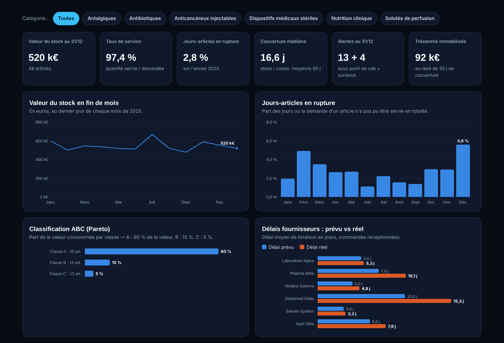

# Pilotage des stocks d'une pharmacie hospitalière

Tableau de bord de pilotage des stocks : valeur du stock, ruptures, couverture en jours,
classification ABC et fiabilité des délais fournisseurs. Les indicateurs sont calculés
en **SQL (DuckDB)** et **Python (pandas)**.

**👉 [Voir le dashboard en ligne](https://portfolio-fiacre-yehossou.vercel.app/dashboard-stocks-hospitaliers.html)**



> 🔒 **Données 100 % fictives, conformes au RGPD.** Le jeu de données est généré par simulation
> (`generate_data.py`). Il ne contient **aucune donnée patient, aucune donnée de santé et aucune
> donnée personnelle** : seulement des articles, des fournisseurs fictifs et des quantités
> agrégées par jour. Toute ressemblance avec un établissement réel est fortuite.

## Problématique métier

Dans une pharmacie hospitalière, un stock mal piloté coûte deux fois :
- **en rupture**, il met en risque la continuité des soins ;
- **en surstock**, il immobilise de la trésorerie et augmente le risque de péremption.

L'objectif est de donner aux équipes (pharmaciens, acheteurs, logisticiens) une vue
partagée et actionnable : quels articles commander maintenant, lesquels réduire,
et quels fournisseurs fiabiliser.

## Indicateurs

| Indicateur | Définition |
|---|---|
| Valeur du stock | Σ (stock fin de journée × prix unitaire), au dernier jour du mois |
| Taux de service | quantité servie / quantité demandée |
| Jours-articles en rupture | part des couples (jour, article) où la demande n'est pas servie en totalité |
| Couverture (jours) | stock final / consommation moyenne des 90 derniers jours |
| Alertes | article sous son point de commande, ou couverture > 60 jours (surstock) |
| Trésorerie immobilisée | valeur du stock au-delà d'une couverture cible de 30 jours |
| Classification ABC | Pareto sur la valeur consommée : A = 80 %, B = 15 %, C = 5 % |
| Fiabilité fournisseur | délai réel moyen vs délai prévu, part des livraisons en retard |

## Résultats (données fictives, année 2025)

- Valeur du stock au 31/12 : **≈ 520 k€** pour 48 références.
- Taux de service : **97,4 %**, avec **2,8 %** de jours-articles en rupture et un pic en décembre.
- **13 articles** sous leur point de commande et **4 en surstock** au 31/12.
- **≈ 92 k€** de trésorerie libérable en ramenant les surstocks à 30 jours de couverture.
- Deux fournisseurs livrent avec 3 à 5 jours de retard en moyenne : leur délai réel doit être
  intégré dans le calcul du point de commande.

## Structure du dépôt

```
├── generate_data.py          # simulation du jeu de données fictif (graine fixe)
├── analyse.py                # exécute les requêtes SQL, exporte les résultats, génère le dashboard
├── sql/kpi_stocks.sql        # requêtes SQL des indicateurs (DuckDB)
├── data/                     # données fictives (CSV)
├── resultats/                # résultats des requêtes (CSV)
├── dashboard/template.html   # gabarit du tableau de bord (HTML/CSS/JS, sans dépendance)
├── dashboard/index.html      # tableau de bord généré, autonome
└── docs/apercu_dashboard.png
```

## Modèle de données

| Table | Grain | Colonnes principales |
|---|---|---|
| `articles` | 1 ligne par article | code_article, libelle, categorie, prix_unitaire_eur, fournisseur_id, stock_securite, point_commande, qte_commande |
| `fournisseurs` | 1 ligne par fournisseur | fournisseur_id, raison_sociale, delai_prevu_j |
| `mouvements_journaliers` | 1 ligne par jour et par article | date, code_article, quantite_demandee, quantite_servie, stock_fin_journee |
| `commandes` | 1 ligne par commande | num_commande, code_article, fournisseur_id, date_commande, date_reception, quantite, delai_prevu_j, delai_reel_j |

## Lancer le projet

```bash
pip install -r requirements.txt
python generate_data.py   # régénère les données fictives (résultats reproductibles)
python analyse.py         # calcule les indicateurs et génère dashboard/index.html
```

Ouvrir ensuite `dashboard/index.html` dans un navigateur.

## Compétences mobilisées

SQL (CTE, fonctions de fenêtre, agrégations), Python (pandas), modélisation de données,
définition de KPI supply chain, data visualisation, analyse orientée décision.

---
Projet réalisé par **Fiacre Yehossou** — Data Analyst | Data Steward | Business Analyst ·
[Portfolio](https://portfolio-fiacre-yehossou.vercel.app/) · [LinkedIn](https://www.linkedin.com/in/fiacre-yehossou)
